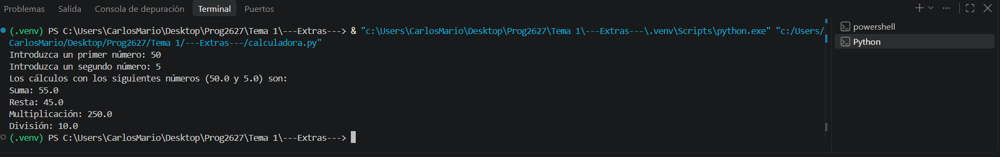

# 2627-PR-U1-PreparacionPrueba

## Desarrolla un programa en Python que solicite dos números decimales y muestre el resultado de las cuatro operaciones aritméticas básicas: suma, resta, multiplicación y división.

**Implementa las siguientes funciones:**

**sumar(numero1, numero2):** devuelve la suma de los dos números.

**restar(numero1, numero2):** devuelve la diferencia entre ambos números.

**multiplicar(numero1, numero2):** devuelve el producto de ambos números.

**dividir(numero1, numero2):** devuelve el cociente de ambos números.

---

La calculadora funciona perfectamente. Si el divisor es 0, saldrá un mensaje de error.

