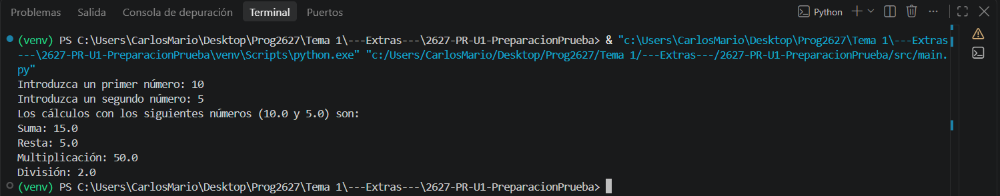
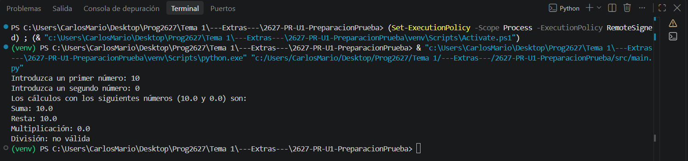

## Práctica Python - Calculadora básica
**Repositorio: 2627-pr-usuarioPasen-calcBasica**:

## Enunciado
Desarrolla un programa en Python que solicite dos números decimales y muestre el resultado de las cuatro operaciones aritméticas básicas: suma, resta, multiplicación y división.

---

## Implementa las siguientes funciones:

sumar(numero1, numero2): devuelve la suma de los dos números.

restar(numero1, numero2): devuelve la diferencia entre ambos números.

multiplicar(numero1, numero2): devuelve el producto de ambos números.

dividir(numero1, numero2): devuelve el cociente de ambos números.

Antes de realizar la división, comprueba que el divisor sea distinto de cero. Si es cero, muestra un mensaje indicando que no se puede realizar la operación.

---

## Ejemplo de ejecución 
10 
4 
Suma: 14.0 
Resta: 6.0 
Multiplicación: 40.0 
División: 2.5 

---

## Requisitos de desarrollo

- Crea un repositorio público de GitHub con el nombre indicado, sustituyendo **usuarioPasen** por tu usuario. 
- Utiliza la estructura básica de un proyecto Python: src/main.py, **README.md** y **.gitignore**. 
- Copia este enunciado en el archivo **README.md**. 
- Implementa una función **main()** que gestione la entrada y salida de datos. 
- Utiliza funciones independientes para realizar los cálculos, con parámetros y valores de retorno. 
- Incluye anotaciones de tipo en variables, parámetros y retornos de las funciones. 
- Documenta cada función de procesamiento mediante una docstring que incluya descripción, parámetros **(:param:)** y valor de   retorno **(:return:)**. 
- Comprueba el funcionamiento del programa con diferentes datos. 
- Registra los cambios con Git y publica el repositorio en GitHub. 

---

## Entrega
Entrega en esta tarea de Moodle la **URL** de tu repositorio público de GitHub.

---

## Ejecutado

La calculadora funciona perfectamente. Si el divisor es 0, saldrá un mensaje sobre división no válida.

